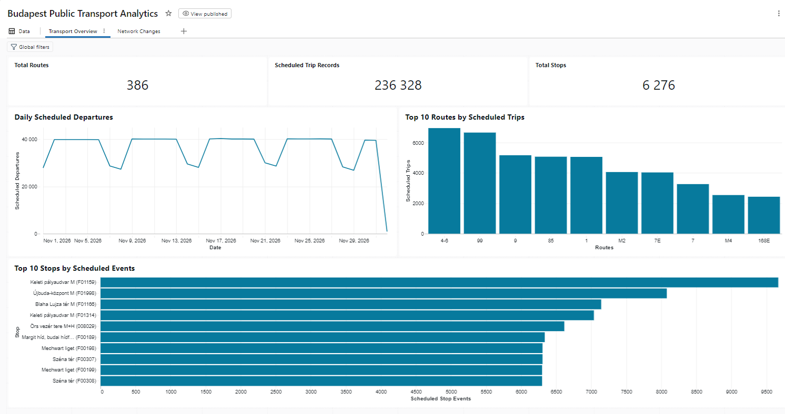
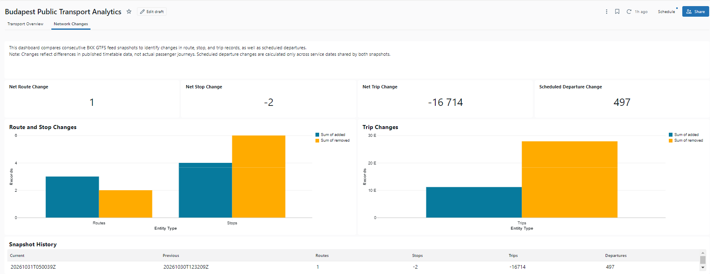
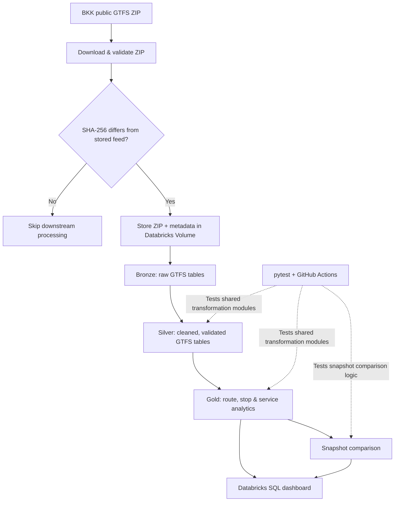
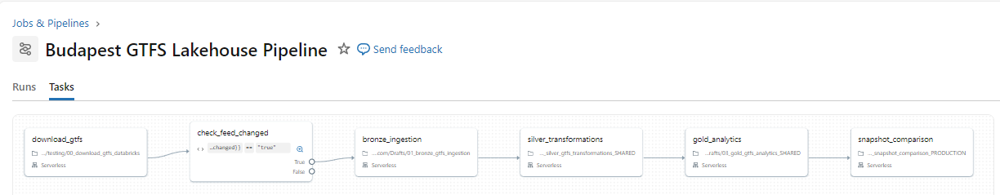

# Budapest Transit Lakehouse

**An incremental GTFS data engineering pipeline for Budapest public transport**, built with **Databricks, PySpark, Delta Lake, and SQL**. The project downloads BKK's published timetable feed, preserves historical versions, transforms the data through Bronze, Silver, and Gold layers, and serves analytics through a two-page Databricks dashboard.

The workflow is scheduled and **only processes a feed when its contents change**. Shared PySpark transformation functions are covered by automated tests that run locally and in GitHub Actions.

> **Scope:** This project analyzes published **scheduled** transport data (GTFS), not live vehicle positions, passenger counts, or actual journey outcomes.

## Dashboard

### Transport Overview

Latest-feed KPIs, daily scheduled departures, busiest routes, and busiest stops.



### Network Changes

Changes between consecutive feed snapshots: route, stop, and trip records added/removed, plus the change in scheduled departures on dates covered by both versions.



The dashboard definition, including both pages and their SQL datasets, is exported at [`databricks/dashboards/`](databricks/dashboards/). The interactive published dashboard requires appropriate access to the Databricks workspace; the screenshots above are available to everyone browsing this repository.

## Architecture



The pipeline is orchestrated by a **six-task Databricks Job**, scheduled daily at approximately **06:00 Europe/Budapest**. A condition task checks `feed_changed` and skips processing if the feed is unchanged.



The exported orchestration configuration is at [`databricks/jobs/budapest_gtfs_pipeline.yml`](databricks/jobs/budapest_gtfs_pipeline.yml).

## Data layers

| Layer | Purpose | Main outputs |
|---|---|---|
| **Ingestion** | Download BKK GTFS ZIP, validate archive and required files, compare SHA-256 hashes, store new snapshots in a Databricks Volume | Timestamped `.zip` and `.json` metadata |
| **Bronze** | Ingest source GTFS records and associate them with a `snapshot_id` | `bronze_routes`, `bronze_stops`, `bronze_trips`, `bronze_stop_times`, `bronze_calendar_dates` |
| **Silver** | Apply typed transformations, deduplicate/validate records, parse GTFS times, and validate cross-table references | Corresponding `silver_*` Delta tables |
| **Gold** | Aggregate scheduled route statistics, stop activity, hourly departures, and daily service | `gold_route_statistics`, `gold_stop_activity`, `gold_hourly_departures`, `gold_daily_service` |
| **Snapshot comparison** | Compare consecutive complete snapshots, including additions/removals and service changes over shared dates | `gold_snapshot_changes` |

The BKK feed used in this project includes `calendar_dates.txt` rather than `calendar.txt`. GTFS times such as `25:30:00` are handled as departures after midnight relative to the service date.

### Historical snapshots and writes

- Each downloaded version receives a UTC-based `snapshot_id`.
- `replaceWhere` scopes Delta writes to the snapshot being processed, retaining other snapshots.
- The ingestion workflow detects unchanged feed content using SHA-256 before starting downstream work.
- Validation checks run before Silver and Gold writes, and persisted row counts are audited afterward.
- The snapshot comparison uses **overlapping service dates** for departure comparisons, avoiding a misleading difference caused solely by distinct timetable date ranges.

**Important limitation:** Writes to separate Delta tables are separate transactions; the pipeline does **not** provide a single atomic commit across the entire layer.

## Engineering decisions

**Reusable production transformations.** The Databricks Silver and Gold notebooks import shared PySpark modules in `src/` instead of maintaining separate copies of the transformation logic for testing. The same functions are exercised by the test suite.

**Snapshot-aware integrity checks.** Joins and reference checks account for snapshot identity so records from different versions are not accidentally combined.

**GTFS time semantics.** GTFS times may exceed 24 hours. Scheduling logic distinguishes the service date from the actual calendar date of a departure and selects the first stop using `stop_sequence`, rather than the earliest clock value.

**Incremental feed processing.** An unchanged ZIP ends the scheduled workflow after the conditional check, avoiding unnecessary ingestion and transformations.

**Change detection beyond row counts.** Snapshot comparisons count added and removed IDs, so a feed can exhibit changes even if its overall route/stop count stays constant.

## Repository structure

```text
.
├── .github/workflows/tests.yml        # Continuous integration
├── databricks/
│   ├── 00_download_gtfs_databricks.py
│   ├── bronze/                         # Bronze ingestion notebook
│   ├── silver/                         # Shared Silver production notebook
│   ├── gold/                           # Gold analytics + snapshot comparison notebooks
│   ├── dashboards/                     # Exported .lvdash.json dashboard definition
│   └── jobs/                           # Exported Databricks Job YAML
├── docs/images/
│   ├── transport_overview.png
│   ├── network_changes.png
│   └── pipeline_job.png
├── src/
│   ├── download_gtfs.py
│   ├── gtfs_transformations.py
│   ├── gtfs_validation.py
│   ├── silver_spark.py
│   ├── gold_spark.py
│   └── snapshot_comparison.py
├── tests/                               # pytest validation and PySpark tests
├── requirements.txt
└── README.md
```

## Local testing

**Prerequisites:** Python 3.13 and Java 21 (used for the local Spark test environment).

```bash
python -m venv .venv
```

Activate the virtual environment:

```powershell
# Windows PowerShell
.\.venv\Scripts\Activate.ps1
```

```bash
# macOS/Linux
source .venv/bin/activate
```

Install dependencies and run the test suite:

```bash
python -m pip install -r requirements.txt
python -m pytest tests/ -v --tb=short
```

`requirements.txt` pins the tested versions of PySpark and pytest. The suite currently contains **44 tests**, covering archive validation, GTFS time parsing, Silver and Gold transformations, integrity rules, and snapshot comparison edge cases.

GitHub Actions runs the tests on pushes and pull requests to `main`:

[](https://github.com/kovacsbence040518/budapest-transit-lakehouse/actions/workflows/tests.yml)

## Databricks deployment notes

The local tests do **not** require access to the Databricks workspace. Executing the end-to-end ingestion and SQL dashboard **does** require a Databricks environment with appropriate permissions, compute, and storage.

The deployed project uses:

- A Databricks Volume for raw GTFS archives and metadata (configured in the download notebook).
- Delta tables under `workspace.default`.
- Databricks workspace notebooks and importable Python files for the shared transformation modules.
- A scheduled Databricks Job whose definitions are exported as YAML.
- A Databricks SQL dashboard whose definition is exported as `.lvdash.json`.

The committed YAML is a **reference export of the running Job**, not a fully portable one-click deployment. Its notebook paths contain a `YOUR_DATABRICKS_USER` placeholder and retain the original workspace folder layout. Replace the placeholder and adjust the paths to match your own workspace. To reproduce the pipeline in another workspace, upload the required notebooks and shared modules, create or configure the Volume, update paths and schema references, and import/adapt the Job and dashboard definitions. Keep authentication and workspace-specific configuration out of source control. The running Job in the original workspace is unchanged by edits to this reference YAML.

## Limitations

- GTFS describes **planned timetables**, not real-time vehicle movement or ridership.
- Feed snapshots may cover different date windows; raw trip-record count changes do not directly imply equal changes in actual daily service.
- The snapshot comparison uses shared service dates for scheduled-departure changes.
- Table-level Delta writes are snapshot-scoped but are **not atomic across multiple output tables**.
- The exported dashboard definition references tables in the original Databricks catalog and requires adaptation in another workspace.
- Continuous integration checks the shared Python/PySpark logic; it does not deploy the Databricks Job or run a full cloud integration test on each push.

## Problems encountered and solutions

- **Different implementations in notebooks and tests:** Early notebook versions contained transformation logic separate from the Python modules exercised by pytest. Silver, Gold, and snapshot comparison now import the shared modules, so tests and production use the same transformation functions.
- **Extra rows and stale results during reruns:** Snapshot-aware `replaceWhere` writes replace only the current snapshot’s rows, while row-count reconciliation checks what actually persisted. Individual table commits remain separate transactions.
- **Repeated downloads of an unchanged feed:** The downloader hashes the incoming ZIP and compares it to earlier snapshots. The Job’s conditional task skips downstream ingestion when the feed has not changed.
- **Misleading snapshot growth comparisons:** Different GTFS releases can cover different timetable periods. Scheduled departures are therefore compared only across service dates shared by both snapshots, rather than treating a longer date window as growth.

## Potential future improvements

- Move raw feed archives to a general-purpose cloud object store and automate environment provisioning.
- Monitor snapshot freshness and notify on ingestion failures or stale source feeds.
- Add a repeatable deployment workflow for the Job, workspace files, and dashboard rather than relying on reference exports.

## License

Released under the [MIT License](LICENSE).

## Data source

**BKK (Budapesti Közlekedési Központ)** public GTFS timetable feed: [Budapest GTFS ZIP](https://go.bkk.hu/api/static/v1/public-gtfs/budapest_gtfs.zip).

This is an independent educational/portfolio project and is not an official BKK product.
